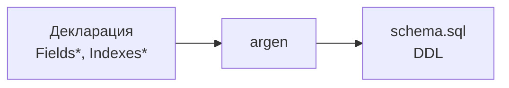

# Генератор схемы

Автоматическая генерация DDL схемы PostgreSQL из деклараций моделей.

## Обзор

Генератор создаёт SQL DDL из деклараций go-activerecord:



## Использование

```bash
# Генерация схемы
argen --path "model/repository" \
      --declaration "declaration" \
      --destination "generated" \
      --schema_path "etc/database"
```

`--schema_path` — это каталог, а не файл. Артефакты раскладываются по бэкенду и
ключу конфига сервера (`//ar:serverConf:`):

```text
etc/database/
└── postgres/
    └── mydb/
        ├── schema.sql      # полный DDL всех таблиц этой БД
        ├── schema.json     # машинное описание схемы, вход для diff
        └── migrations/     # 001_*.sql, 002_*.sql — по diff со schema.json
```

`schema.json` — это снимок схемы предыдущей генерации. Из diff с ним argen
получает очередную миграцию, поэтому файл нужно хранить в репозитории рядом с
`schema.sql`.

## Пример вывода

Для декларации:

```go
//ar:serverConf:mydb
//ar:namespace:users
//ar:backend:postgres
type FieldsUser struct {
    Id        int64  `ar:"primary_key;init_by_db"`
    Email     string `ar:"unique;size:256"`
    Name      string `ar:"size:128"`
    Status    string `ar:"size:32"`
    Flags     uint32 `ar:""`
    CreatedAt int64  `ar:""`
}

type IndexesUser struct {
    StatusCreated bool `ar:"fields:Status,CreatedAt;order:Status asc,CreatedAt desc"`
    ActiveUsers   bool `ar:"fields:CreatedAt;condition:Status[=]active&&Flags&1[=]1"`
}
```

Генерируется:

```sql
-- DDL Schema for table users
-- Generated by argen

CREATE TABLE IF NOT EXISTS users (
    id BIGSERIAL NOT NULL,
    email VARCHAR(256) NOT NULL DEFAULT '',
    name VARCHAR(128) NOT NULL DEFAULT '',
    status VARCHAR(32) NOT NULL DEFAULT '',
    flags BIGINT NOT NULL DEFAULT 0,
    created_at BIGINT NOT NULL DEFAULT 0,
    PRIMARY KEY (id)
);

CREATE UNIQUE INDEX IF NOT EXISTS idx_users_email ON users (email);

CREATE INDEX IF NOT EXISTS idx_users_statuscreated ON users (status ASC, created_at DESC);

CREATE INDEX IF NOT EXISTS idx_users_activeusers ON users (created_at)
    WHERE status = 'active' AND flags & 1 = 1;
```

## Поддерживаемые возможности

### Типы данных

| Go тип | PostgreSQL | С init_by_db |
|--------|------------|--------------|
| `int64` | BIGINT | BIGSERIAL |
| `int32`, `int` | INTEGER | SERIAL |
| `int16` | SMALLINT | SMALLSERIAL |
| `uint64`, `uint32` | BIGINT | - |
| `uint16`, `uint8` | INTEGER | - |
| `float64` | DOUBLE PRECISION | - |
| `float32` | REAL | - |
| `bool` | BOOLEAN | - |
| `string` | VARCHAR(n) / TEXT | - |
| `postgres.BYTEA` | BYTEA | - |
| `time.Time` | TIMESTAMP | - |

### NOT NULL и DEFAULT

Все поля генерируются как NOT NULL (Go не имеет null):

```sql
name VARCHAR(128) NOT NULL DEFAULT ''
counter BIGINT NOT NULL DEFAULT 0
is_active BOOLEAN NOT NULL DEFAULT false
created_at TIMESTAMP NOT NULL DEFAULT '0001-01-01 00:00:00'
```

### Индексы

```go
type IndexesUser struct {
    // Уникальный индекс
    Email bool `ar:"fields:Email;unique"`

    // Составной индекс с сортировкой
    StatusDate bool `ar:"fields:Status,CreatedAt;order:Status asc,CreatedAt desc"`

    // Условный индекс
    Active bool `ar:"fields:Id;condition:Status[=]active&&DeletedAt[is null]"`
}
```

```sql
CREATE UNIQUE INDEX idx_users_email ON users (email);
CREATE INDEX idx_users_statusdate ON users (status ASC, created_at DESC);
CREATE INDEX idx_users_active ON users (id) WHERE status = 'active' AND deleted_at IS NULL;
```

Значение условия подставляется в `WHERE` литералом типа колонки: строка, bytea и
uuid — в одинарных кавычках, `time.Time` — как `TIMESTAMP '<UTC>'` из числа
секунд unix-времени, числа и `bool` — как есть. Таблица по типам:
[Значения условий](index.md#значения-условий).

### Foreign Keys

Из `FieldsObject*` генерируются FK:

```go
type FieldsObjectOrder struct {
    User int64 `ar:"key:Id;object:User;field:UserId"`
}
```

```sql
CONSTRAINT orders_userid_fkey FOREIGN KEY (userid)
    REFERENCES users (id) ON DELETE CASCADE
```

## Именование

| Элемент | Формат | Пример |
|---------|--------|--------|
| Таблица | snake_case из namespace | `users` |
| Колонки | lowercase | `created_at` |
| PK | `{table}_pkey` | `users_pkey` |
| Индексы | `idx_{table}_{name}` | `idx_users_email` |
| FK | `{table}_{column}_fkey` | `orders_userid_fkey` |

## JSON представление

Генератор также создаёт JSON схему:

```go
type Table struct {
    Name        string       `json:"name"`
    Backend     string       `json:"backend"`
    Columns     []Column     `json:"columns"`
    PrimaryKey  []string     `json:"primary_key"`
    Indexes     []Index      `json:"indexes"`
    ForeignKeys []ForeignKey `json:"foreign_keys"`
}

type Column struct {
    Name       string `json:"name"`
    Type       string `json:"type"`
    GoType     string `json:"go_type"`
    PrimaryKey bool   `json:"primary_key"`
    NotNull    bool   `json:"not_null"`
    Default    string `json:"default"`
    Size       int64  `json:"size"`
    Position   int    `json:"position"`
}
```

## Миграции

Генератор поддерживает создание миграций из diff:

```go
// Внутренний API
diff := schema.CompareTables(oldTable, newTable)
migration, _ := generator.GenerateMigration(diff, "users")
```

Результат:

```go
type Migration struct {
    Up          []string  // ALTER TABLE ADD COLUMN ...
    Down        []string  // ALTER TABLE DROP COLUMN ...
    Description string    // "add column email, drop index idx_old"
}
```

### Поддерживаемые изменения

| Изменение | Up | Down |
|-----------|-----|------|
| Добавление колонки | ADD COLUMN | DROP COLUMN |
| Удаление колонки | DROP COLUMN | -- комментарий (см. [roadmap](../roadmap.md)) |
| Изменение типа | ALTER TYPE | ALTER TYPE |
| Изменение NOT NULL | SET/DROP NOT NULL | DROP/SET NOT NULL |
| Изменение DEFAULT | SET/DROP DEFAULT | SET/DROP DEFAULT |
| Добавление индекса | CREATE INDEX | DROP INDEX |
| Удаление индекса | DROP INDEX | -- комментарий (см. [roadmap](../roadmap.md)) |

## Детерминированность вывода

Повторный прогон argen на неизменённых декларациях даёт **побайтно те же**
`schema.sql`, `schema.json` и файлы миграций: новых файлов миграций не
появляется. Это позволяет проверять регенерацию через `git diff --exit-code`.

Что для этого зафиксировано:

| Что | Порядок |
|-----|---------|
| Блоки таблиц в `schema.sql` (и в `space.cfg` у octopus) | по имени таблицы |
| Таблицы в миграции (added / modified / dropped) | по имени таблицы |
| Колонки и индексы в миграции | в порядке объявления, изменённые — по имени |
| Части `WHERE` условного индекса | по номеру поля в декларации |
| `CONSTRAINT` внешних ключей | по имени поля связи |
| Таблицы в `schema.json` | по имени (ключи JSON-объекта сортируются) |

!!! note "Поле `generated` в `schema.json`"

    Метка времени в `schema.json` обновляется **только при реальном изменении
    схемы**. Если содержимое схемы не изменилось, argen переносит метку из
    предыдущей версии файла, и файл остаётся неизменным. Так метка сохраняет
    смысл («когда схема менялась в последний раз») и при этом не создаёт шум в
    диффе на каждом прогоне.

Порядок частей `WHERE` важен не только для читаемости: `condition` в
`schema.json` сравнивается как строка, поэтому плавающий порядок условий
выглядел для diff'а как изменение индекса и приводил к лишней миграции с
`DROP INDEX` / `CREATE INDEX`.

## Ограничения

!!! warning "Текущие ограничения"

1. **Схема** — всегда `public` (планируется `//ar:schema:`)
2. **ENUM** — не поддерживается (планируется)
3. **Партиционирование** — не поддерживается
4. **Триггеры БД** — не генерируются
5. **Stored procedures** — не генерируются

## Makefile интеграция

```makefile
.PHONY: schema
schema: ## Generate PostgreSQL DDL schema
	argen --path "model/repository" --schema_path "etc/database"

.PHONY: migrate
migrate: schema ## Generate and apply migrations
	psql -d mydb -f etc/database/postgres/mydb/schema.sql
```

## Best Practices

### 1. Храните схему в репозитории

```text
project/
├── model/
│   └── repository/
│       └── declaration/
└── etc/
    └── database/
        └── postgres/
            └── mydb/
                ├── schema.sql
                ├── schema.json
                └── migrations/
```

### 2. Используйте для документации

```bash
# Генерация схемы, пригодной для публикации в документации
argen --path "model/repository" --schema_path "etc/database"
cp etc/database/postgres/mydb/schema.sql docs/database-schema.sql
```

### 3. Сравнивайте с production

```bash
# Экспорт текущей схемы
pg_dump -s mydb > current.sql

# Генерация из деклараций
argen --schema_path "etc/database"

# Сравнение
diff current.sql etc/database/postgres/mydb/schema.sql
```

### 4. Проверяйте регенерацию в CI

Вывод генератора детерминирован, поэтому «схема в репозитории соответствует
декларациям» проверяется обычным `git diff`:

```bash
argen --path "model/repository" --schema_path "etc/database"
git diff --exit-code etc/database
```

## Следующие шаги

- [Индексы](../declaration/indexes.md) — декларация индексов
- [Поля](../declaration/fields.md) — декларация полей
